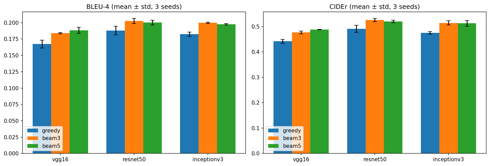
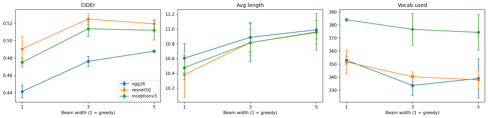
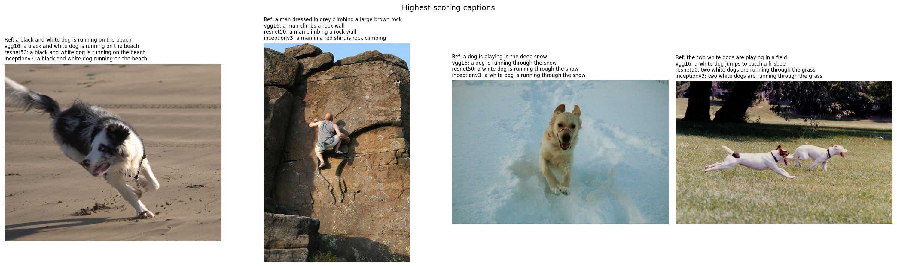
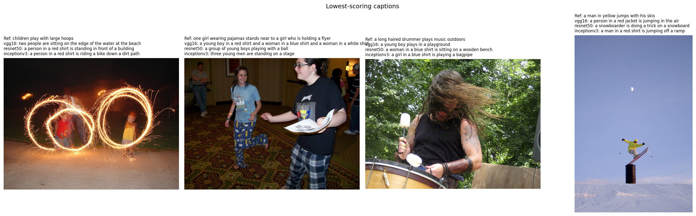

# Image Caption Generator: CNN Encoders and Decoding Strategies

A CNN–LSTM model that generates captions for images, trained on Flickr8k. The project compares three pretrained CNN encoders (VGG16, ResNet50, InceptionV3) and three decoding methods (greedy search, beam search with k = 3 and k = 5) under identical training conditions, with three random seeds per model and significance testing.


## Key Findings

- **ResNet50 and InceptionV3 significantly outperform VGG16** for every decoding method (paired bootstrap, p ≤ 0.02), even though VGG16 has the largest feature vector (4,096 vs 2,048).
- **ResNet50 and InceptionV3 are statistically tied** (p = 0.11–0.46).
- **Beam search (k = 3) beats greedy decoding** by 0.034–0.039 CIDEr for all encoders (p < 0.001). **k = 5 gives no further gain** and is slower.
- **Beam search trades diversity for accuracy**: captions become longer and repeat less, but use fewer distinct words.
- **InceptionV3 produces the most varied vocabulary** (~384 distinct words vs ~352) at similar CIDEr.
- About **91–93% of generated captions are novel** (not copied from the training set).

## Results

Flickr8k test set (1,000 images), mean ± std over 3 seeds. Best configuration in bold.

| Encoder | Decoding | BLEU-1 | BLEU-4 | ROUGE-L | CIDEr |
|---|---|---|---|---|---|
| VGG16 | Greedy | 0.577 ± 0.008 | 0.167 ± 0.006 | 0.438 ± 0.003 | 0.441 ± 0.007 |
| VGG16 | Beam k=3 | 0.593 ± 0.005 | 0.184 ± 0.001 | 0.448 ± 0.001 | 0.476 ± 0.006 |
| VGG16 | Beam k=5 | 0.593 ± 0.005 | 0.188 ± 0.005 | 0.450 ± 0.001 | 0.488 ± 0.001 |
| ResNet50 | Greedy | 0.604 ± 0.010 | 0.188 ± 0.007 | 0.455 ± 0.004 | 0.491 ± 0.014 |
| **ResNet50** | **Beam k=3** | **0.609 ± 0.004** | **0.203 ± 0.004** | **0.464 ± 0.001** | **0.525 ± 0.006** |
| ResNet50 | Beam k=5 | 0.606 ± 0.003 | 0.200 ± 0.004 | 0.462 ± 0.002 | 0.520 ± 0.005 |
| InceptionV3 | Greedy | 0.594 ± 0.003 | 0.182 ± 0.003 | 0.450 ± 0.004 | 0.475 ± 0.005 |
| InceptionV3 | Beam k=3 | 0.607 ± 0.006 | 0.200 ± 0.001 | 0.460 ± 0.003 | 0.514 ± 0.009 |
| InceptionV3 | Beam k=5 | 0.601 ± 0.004 | 0.197 ± 0.001 | 0.458 ± 0.003 | 0.512 ± 0.011 |

Full results, including BLEU-2/3, METEOR, caption statistics and significance tests, are in [`results/`](results/).





## Method

```
Image → CNN (frozen) → features → BatchNorm → LSTM initial state
Caption so far → Embedding → LSTM → softmax → next word

```

- **Dataset:** Flickr8k with the standard split (6,000 train / 1,000 validation / 1,000 test images, 5 captions each).
- **Encoders:** VGG16 (fc2, 4,096-d), ResNet50 and InceptionV3 (global average pooling, 2,048-d), ImageNet weights, frozen. Features are extracted once and cached.
- **Decoder:** image features initialise the LSTM's hidden and cell states (Show and Tell style); 256-d word embeddings, 512-unit LSTM, dropout 0.5.
- **Training:** teacher forcing, Adam (lr 5e-4), batch size 64, early stopping on validation loss (patience 3, max 30 epochs). Identical settings for all encoders; seeds 42, 7 and 123.
- **Decoding:** greedy search and length-normalised beam search (k = 3, 5).
- **Evaluation:** BLEU-1–4, METEOR (NLTK), ROUGE-L, CIDEr, vocabulary used, novelty, repetition rate, decoding time; paired bootstrap test (10,000 resamples) on per-image CIDEr.

## Example Captions





Common errors: repeating a phrase ("a man in a blue shirt and a blue shirt"), falling back on frequent training phrases for unusual scenes, and objects that are rare in Flickr8k (a kitten was captioned as "a small dog").

## Project Structure

```
notebooks/
  01_preprocessing.ipynb        caption cleaning, official split, vocabulary
  02_feature_extraction.ipynb   VGG16 / ResNet50 / InceptionV3 features
  03_training.ipynb             9 training runs (3 encoders × 3 seeds)
  04_evaluation.ipynb           metrics, significance tests, error analysis
  05_demo.ipynb                 Gradio web demo
results/                        figures and result tables
```

## How to Run

The notebooks are designed for Google Colab (T4 GPU). Run them in order, 01 → 05. Processed data, features and models are saved to Google Drive, so each notebook can be run in a separate session.

The demo notebook (05) launches a Gradio web app: upload an image, choose the encoder and decoding method, and watch the caption being generated word by word with the top-5 candidate words at each step.

## Limitations

- Trained and evaluated on Flickr8k only, which mostly contains people, dogs and outdoor scenes.
- The decoder uses one global image vector, without attention over image regions.
- METEOR uses the NLTK implementation and is not comparable with values from the official scorer.
- No human evaluation.

## Dataset

[Flickr8k](https://www.kaggle.com/datasets/adityajn105/flickr8k) (Hodosh et al., 2013). Standard split files from [Flickr8k_text](https://github.com/jbrownlee/Datasets/releases/tag/Flickr8k).

## Tech Stack

Python, TensorFlow/Keras, NLTK, pycocoevalcap, Gradio, Matplotlib, Google Colab
