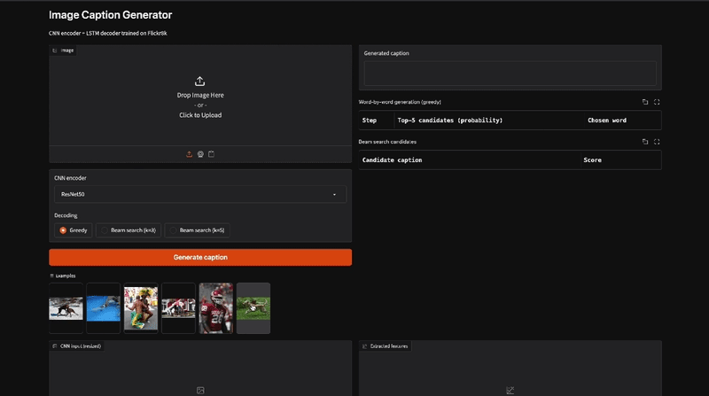

# Image Caption Generator: Comparing CNN Encoders and Decoding Strategies

A CNN–LSTM model that generates natural-language captions for images, with a comparison of three pretrained CNN encoders (VGG16, ResNet50, InceptionV3) and two decoding strategies (greedy and beam search) on Flickr8k.

<!-- Add demo GIF here on Day 5:  -->

## Problem Statement
Caption quality in CNN–LSTM models depends on the CNN used to extract image features and on how words are selected during generation. This project compares three CNN encoders and two decoding strategies to find which combination produces the most accurate captions.

## Architecture
Image → Pretrained CNN → Feature vector → LSTM decoder → Caption (word by word)

## Dataset
[Flickr8k](https://www.kaggle.com/datasets/adityajn105/flickr8k): 8,091 images, 5 captions each.
Split by image: 6,000 train / 1,000 validation / 1,091 test (seed 42).

## Results
<!-- Fill on Day 4 -->
| CNN Encoder | Decoding | BLEU-1 | BLEU-2 | BLEU-3 | BLEU-4 | Time/caption |
|---|---|---|---|---|---|---|
| VGG16 | Greedy | | | | | |
| VGG16 | Beam (k=3) | | | | | |
| ResNet50 | Greedy | | | | | |
| ResNet50 | Beam (k=3) | | | | | |
| InceptionV3 | Greedy | | | | | |
| InceptionV3 | Beam (k=3) | | | | | |

## Project Structure
```
notebooks/
  01_preprocessing.ipynb
  02_feature_extraction.ipynb
  03_training.ipynb
  04_evaluation.ipynb
  05_demo.ipynb
results/      figures and scores
assets/       demo GIF / screenshots
```

## How to Run
Open the notebooks in Google Colab in order (01 → 05). Processed files are saved to Google Drive.

## Paper
<!-- Add link once published -->

## Tech Stack
Python, TensorFlow/Keras, Gradio, Matplotlib, Google Colab
